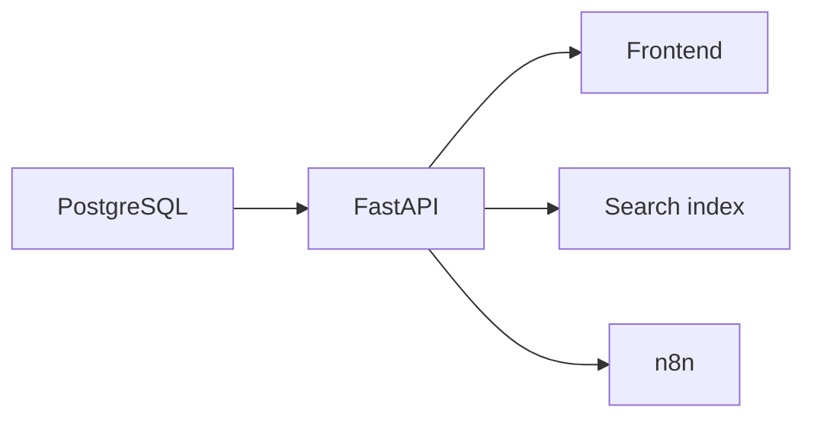

# Vowora Database Architecture

## Architecture intent

- PostgreSQL is the transactional source of truth.
- The database stores users, profiles, events, quotes, proposals, bookings, invoices, subscriptions, plans, audit events, and file metadata.
- All monetary values use integer minor units plus ISO currency.
- All timestamps use UTC; event records also retain an IANA timezone.
- Public search reads from a projection that excludes private fields.

## Components

## Status

- **Implemented** — schema document exists in `docs/vowora-database-schema.md`.
- **Partially implemented** — physical database is not provisioned.
- **Blocked** — backend delivery.
