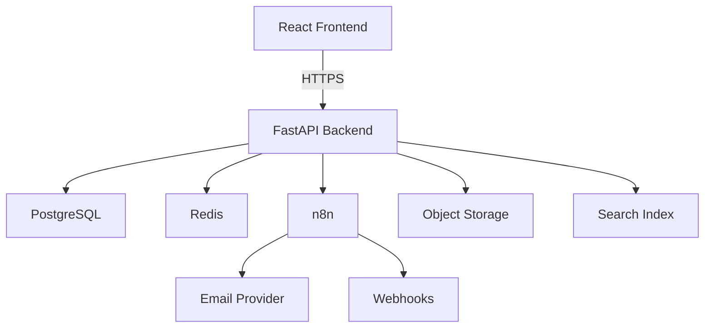

# Vowora System Overview

Vowora is a global wedding and event marketplace connecting customers with verified vendors and planners. The product uses a black-and-white visual system and is owned and developed by Permetheon and Solvx.

## Principles

- The platform is a discovery and coordination tool, not a payment custody system in MVP.
- Customers pay vendors and planners directly.
- The platform preserves invoices, records payment status, and keeps evidence clearly labeled.
- PostgreSQL is the source of truth.
- The React frontend delegates business logic, authentication, authorization, subscriptions, entitlements, CRM, workflow transitions, audit events, and financial records to the FastAPI backend.
- n8n drives notifications, reminders, CRM actions, onboarding, expiry alerts, and approved plan templates.
- No live chat, recommendation intelligence, or gateway payments are built before their approved scope.

## Core roles

| Role | Description |
| --- | --- |
| Customer | Plans events, browses vendors, shortlists, approves proposals, tracks bookings and invoices, pays vendors directly. |
| Vendor | Lists services, packages, rates, and availability; receives requests; submits quotes; issues invoices; manages CRM. |
| Planner | Coordinates events; builds shortlists; compares quotes; creates proposals; manages CRM; tracks bookings. |
| Admin | Configures plans, verifies users, manages categories, assignments, disputes, subscriptions, audit review, and support actions. |

## System components

## Data ownership

- PostgreSQL stores transactional records, users, profiles, events, proposals, quotes, invoices, subscriptions, audit events, and file metadata.
- Object storage stores images, portfolios, invoices, identity files, and payment evidence. Only metadata and storage paths are stored in the database.
- The frontend never stores private file keys.

## Documentation purpose

This documentation system covers product strategy, engineering architecture, operations, testing, security, legal, and emergency recovery. Every document is marked with its implementation status: Implemented, Partially implemented, Planned, Proposed, or Blocked.
